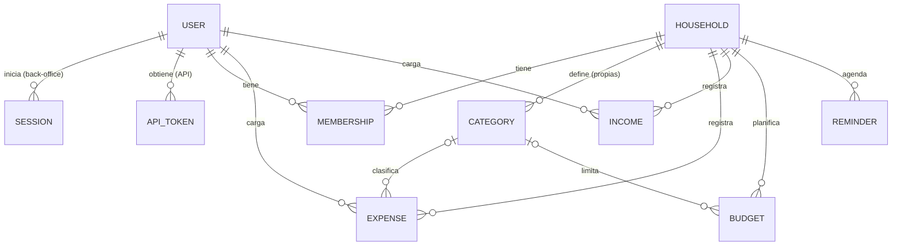

# CuentaHogar · Back-end (TP N° 1 — Programación IV)

Aplicación Ruby on Rails para el **control de gastos personal y del hogar**. Es el back-end de la PWA
CuentaHogar: los miembros de un hogar cargan gastos (con comprobante), registran ingresos, arman
presupuestos mensuales y reciben avisos de vencimientos.

El proyecto tiene dos partes separadas:

- **Back-office** (`/admin`): panel web para administradores, con autenticación nativa de Rails 8.
- **API JSON versionada** (`/api/v1`): la consume la aplicación del usuario final (TP N° 2). Autenticación por token.

---

## Requisitos

- Ruby 4.0 (versión exacta en `.ruby-version`: 4.0.7)
- Bundler (viene con Ruby)
- Git
- No hace falta instalar SQLite aparte: la gem `sqlite3` lo trae incluido.
- En **Windows**: [RubyInstaller](https://rubyinstaller.org) versión **Ruby+Devkit**, y al final de la
  instalación ejecutar `ridk install` con las opciones 1 y 3 (MSYS2 y toolchain), necesarias para
  compilar gems nativas.

Rails 8.1 se instala con `bundle install`; no hace falta instalarlo aparte.

## Instalación

```bash
git clone https://github.com/ventureiranm/cuentaHogar-ruby.git
cd cuentaHogar-ruby
bundle install
bin/rails db:prepare     # crea la base con el esquema (si la base es nueva, también carga los seeds)
bin/rails db:seed        # carga o completa los datos de ejemplo (se puede correr más de una vez)
bin/rails server         # o bin/dev
```

Abrir <http://localhost:3000> (redirige al login del back-office).

> **Windows (PowerShell o cmd):** los scripts de `bin/` se ejecutan anteponiendo `ruby`, por ejemplo
> `ruby bin/rails db:prepare`, `ruby bin/rails server` o `ruby bin/rubocop`. Desde Git Bash funcionan
> tal cual.

## Credenciales

| Contexto | Email | Contraseña |
|---|---|---|
| Back-office (admin) | `admin@cuentahogar.com` | `admin12345` |
| API (usuario final) | `lucia.martinez@mail.com` | `cuentahogar123` |
| API (usuario final) | `diego.martinez@mail.com` / `sofia.martinez@mail.com` | `cuentahogar123` |

Las credenciales del admin se pueden cambiar al sembrar: `ADMIN_EMAIL=... ADMIN_PASSWORD=... bin/rails db:seed`.

## Calidad y tests

```bash
bin/rails test           # modelos, validaciones, lógica de negocio, mailers, back-office y API
bin/rubocop              # estilo (rubocop-rails-omakase, sin reglas ignoradas)
bin/brakeman --no-pager  # análisis de seguridad
```

En Linux y macOS los tests corren en paralelo (un proceso por núcleo). En Windows no existe `fork()`,
así que corren en un solo proceso (ver `test/test_helper.rb`).

## Emails (Action Mailer)

| Email | Cuándo se envía |
|---|---|
| `UserMailer#welcome` | Al registrarse un usuario desde la API (`POST /api/v1/signup`). |
| `ReminderMailer#due_soon` | A cada miembro del hogar cuando un vencimiento está próximo: botón "Avisar por email" del back-office o la tarea `bin/rails reminders:notify` (vencimientos de los próximos 3 días que todavía no se avisaron). |

- Vistas previas: <http://localhost:3000/rails/mailers>
- En desarrollo, sin configuración, los mails se guardan en `tmp/mails/`.
- Para enviarlos de verdad por SMTP (ej. Gmail con contraseña de aplicación):

```bash
export SMTP_ADDRESS=smtp.gmail.com SMTP_PORT=587
export SMTP_USERNAME=tu_cuenta@gmail.com SMTP_PASSWORD=tu_contraseña_de_aplicacion
export MAILER_FROM="CuentaHogar <tu_cuenta@gmail.com>"
bin/rails server
```

## Archivos (Active Storage)

Cada gasto puede tener un **comprobante** (`Expense#receipt`: foto del ticket o factura en JPG, PNG o PDF,
máximo 5 MB). Se adjunta desde el formulario del back-office o desde la API con `multipart/form-data`,
y la API devuelve la URL de descarga en `receipt_url`.

---

## Modelo de datos



| Modelo | Descripción | Reglas principales |
|---|---|---|
| **User** | Persona que usa el sistema. `role`: `member` (usuario final, API) o `admin` (back-office). | Nombre obligatorio, email único y con formato válido (se normaliza a minúsculas), contraseña de 8+ caracteres (`has_secure_password`). |
| **Session** | Sesión del back-office (generador de autenticación de Rails 8). | — |
| **ApiToken** | Token del usuario final. Solo se guarda su digest SHA-256; vence a los 30 días. | Digest único, fecha de vencimiento obligatoria. |
| **Household** | Hogar compartido (ej. "Hogar Martínez"). | Nombre obligatorio, moneda ARS o USD. |
| **Membership** | Relación usuario–hogar. `role`: `member` u `owner`. | Un usuario no puede estar dos veces en el mismo hogar. |
| **Category** | Categoría de gasto. Sin hogar = global (para todos). | Nombre único dentro del hogar, color hexadecimal. Al borrarla, sus gastos quedan pendientes de revisión. |
| **Expense** | Gasto. Sin hogar = personal. Sin categoría = pendiente de revisión. `source`: `manual` o `imported` (resumen bancario). Puede ser recurrente y tener comprobante. | Monto > 0, fecha y detalle obligatorios; el usuario debe ser miembro del hogar; la categoría debe ser global o del mismo hogar; comprobante JPG/PNG/PDF ≤ 5 MB. |
| **Income** | Ingreso o aporte de un miembro. | Monto > 0, fecha y detalle obligatorios; el usuario debe ser miembro del hogar. |
| **Budget** | Presupuesto mensual del hogar, general (sin categoría) o por categoría. Calcula gastado, restante, % de uso y si se excedió. | Período = primer día del mes; un solo presupuesto por hogar/categoría/mes; monto > 0. |
| **Reminder** | Vencimiento (tarjeta, servicios, prepaga). Estado: pendiente, vence hoy, vencido o pagado. | Concepto y fecha obligatorios; monto opcional > 0. |

La lógica del "Resumen del mes" (gastos, variación contra el mes anterior, presupuesto, saldo disponible,
pendientes de revisión y gasto por categoría) está en el servicio `MonthlySummary` (`app/services`).
Se calcula para un hogar (`MonthlySummary.new(household, mes)`) o para el ámbito Personal de un usuario
(`MonthlySummary.personal(user, mes)`), con los mismos cálculos.
El comportamiento común de gastos e ingresos está en el concern `HouseholdScoped`.

---

## Back-office (`/admin`)

Solo pueden ingresar usuarios con rol `admin`. Incluye:

- **Resumen**: totales del mes, últimos movimientos, próximos vencimientos y estado de cada hogar.
- **ABM completos** de usuarios, hogares (con alta y baja de miembros), categorías, gastos (con comprobante y filtro de pendientes), ingresos, presupuestos y vencimientos (con envío de aviso por email).

## API (`/api/v1`)

Todas las respuestas son JSON. Salvo `signup` y `login`, todos los endpoints requieren el header:

```
Authorization: Bearer <token>
```

La API no usa cookies ni la sesión del back-office: hereda de `ActionController::API` y solo acepta el token.
El token se obtiene con `login` o `signup`, vence a los 30 días y en la base solo se guarda su digest SHA-256.

Los errores tienen la forma `{ "errors": ["mensaje", ...] }` con status `400` (falta un parámetro),
`401` (token inválido o ausente), `403` (sin permiso), `404` (no existe o no es del usuario) o `422` (validación).

### Autenticación

| Método | Ruta | Descripción |
|---|---|---|
| POST | `/api/v1/signup` | Registro. Body: `{ "user": { "name", "email_address", "password", "password_confirmation" } }`. Envía el email de bienvenida y devuelve un token. |
| POST | `/api/v1/login` | Body: `{ "email_address", "password" }`. Devuelve `{ token, token_type, expires_at, user }`. |
| DELETE | `/api/v1/logout` | Revoca el token actual. |
| GET | `/api/v1/profile` | Datos del usuario y sus hogares. |
| PATCH | `/api/v1/profile` | Body: `{ "user": { "name", "password", "password_confirmation", "password_challenge" } }`. Para cambiar la contraseña hay que enviar la actual en `password_challenge`. |

### Hogares y categorías

| Método | Ruta | Descripción |
|---|---|---|
| GET | `/api/v1/households` | Hogares del usuario con sus miembros (`id` del usuario, `membership_id`, nombre, iniciales y rol). |
| POST | `/api/v1/households` | Crea un hogar (`{ "household": { "name", "currency" } }`); el creador queda como `owner`. |
| GET | `/api/v1/households/:id` | Detalle de un hogar. |
| GET | `/api/v1/households/:id/summary?month=YYYY-MM` | Resumen del mes del hogar (totales, variación, presupuesto, disponible, pendientes, gasto por categoría). Sin `month`, el mes actual. |
| GET | `/api/v1/summary?month=YYYY-MM` | Resumen del mes del ámbito **Personal** (gastos e ingresos del usuario sin hogar). Mismos campos que el de un hogar, con `household_id: null`. No hay presupuestos personales, así que `budget_total` es 0 y `available` queda en negativo por lo gastado. |
| POST | `/api/v1/households/:id/memberships` | Invita a un usuario registrado: `{ "email_address": "..." }`. Solo el `owner` del hogar (si no, `403`). Lo agrega como `member` y devuelve el miembro. Email no registrado: `404`; ya es miembro: `422`. |
| DELETE | `/api/v1/households/:id/memberships/:membership_id` | Quita un miembro. Solo el `owner` (si no, `403`); no puede quitarse a sí mismo (`422`). |
| GET | `/api/v1/categories?household_id=` | Categorías globales + las de los hogares del usuario. |
| POST | `/api/v1/categories` | Crea una categoría propia de un hogar del usuario: `{ "category": { "household_id", "name", "color" } }`. Nunca crea categorías globales (esas se crean desde el back-office): sin `household_id` responde `400`; con un hogar ajeno, `404`. |

### Gastos e ingresos

| Método | Ruta | Descripción |
|---|---|---|
| GET | `/api/v1/expenses` | Filtros: `household_id`, `scope=personal`, `month=YYYY-MM`, `category_id`, `pending=true`, `limit`. |
| GET | `/api/v1/expenses/:id` | Detalle (incluye `receipt_url`). |
| POST | `/api/v1/expenses` | `{ "expense": { "description", "amount", "spent_on", "household_id", "category_id", "recurring", "notes" } }`. Para adjuntar comprobante enviar `multipart/form-data` con `expense[receipt]`. |
| PATCH | `/api/v1/expenses/:id` | Mismos campos (por ejemplo, asignar categoría a un gasto importado). |
| DELETE | `/api/v1/expenses/:id` | Elimina el gasto. |
| GET / POST / PATCH / DELETE | `/api/v1/incomes[/:id]` | Igual que gastos, con `{ "income": { "description", "amount", "received_on", "household_id" } }`. |

### Planificación

| Método | Ruta | Descripción |
|---|---|---|
| GET | `/api/v1/budgets?household_id=&month=YYYY-MM` | Presupuestos con `spent`, `remaining`, `usage_percentage` y `exceeded`. |
| POST | `/api/v1/budgets` | `{ "budget": { "household_id", "category_id", "period": "YYYY-MM", "amount" } }`. |
| GET | `/api/v1/reminders` | Filtros: `household_id`, `status=pending|paid|overdue|all`, `days=N` (pendientes de los próximos N días). |
| POST | `/api/v1/reminders` | `{ "reminder": { "household_id", "title", "amount", "due_on" } }`. |
| PATCH | `/api/v1/reminders/:id` | Modifica título, monto o fecha. |
| PATCH | `/api/v1/reminders/:id/pay` | Marca el vencimiento como pagado. |

### Colección de Postman

En [`docs/CuentaHogar.postman_collection.json`](docs/CuentaHogar.postman_collection.json) hay una colección
(formato v2.1) con un request por cada endpoint de la API, agrupados en cuatro carpetas: Autenticación,
Hogares y categorías, Gastos e ingresos, y Planificación. Los bodies de ejemplo usan los datos de los seeds.

Para usarla:

1. Levantar el server con los seeds cargados (`bin/rails db:seed` y `bin/rails server`).
2. En Postman: **Import** → elegir el archivo `docs/CuentaHogar.postman_collection.json`.
3. Ejecutar **Autenticación → Login**: guarda el token en la variable de colección `token`. Todos los
   demás requests lo usan solos (autorización Bearer heredada de la colección).
4. Ejecutar el resto a mano, o la colección completa con **Run collection** (Runner), en orden.

Detalles:

- La URL del server está en la variable de colección `base_url` (`http://localhost:3000` por defecto).
- Los requests de alta guardan el id creado (`expense_id`, `income_id`, `reminder_id`, `membership_id`)
  y los de ver, editar y eliminar operan sobre ese registro, sin tocar los datos de los seeds.
- **Registro** crea un usuario con un email único en cada ejecución; **Invitar miembro** agrega a ese
  usuario al Hogar Martínez y **Quitar miembro** lo quita.
- **Logout** hace un login aparte y revoca ese token, para no invalidar el de la colección.
- **Crear gasto con comprobante** envía `multipart/form-data`: en `expense[receipt]` hay que elegir un
  archivo (por ejemplo `test/fixtures/files/comprobante.png`).
- **Crear categoría del hogar** y **Crear presupuesto** responden 422 si se ejecutan dos veces sobre la
  misma base: el nombre de la categoría y el presupuesto por categoría y mes son únicos.

### Ejemplo rápido con curl

```bash
TOKEN=$(curl -s -X POST http://localhost:3000/api/v1/login \
  -H "Content-Type: application/json" \
  -d '{"email_address":"lucia.martinez@mail.com","password":"cuentahogar123"}' | ruby -rjson -e 'puts JSON.parse(STDIN.read)["token"]')

curl -s http://localhost:3000/api/v1/households -H "Authorization: Bearer $TOKEN"
curl -s "http://localhost:3000/api/v1/expenses?pending=true" -H "Authorization: Bearer $TOKEN"

curl -s -X POST http://localhost:3000/api/v1/expenses -H "Authorization: Bearer $TOKEN" \
  -F "expense[description]=Farmacia" -F "expense[amount]=14780" -F "expense[spent_on]=2026-09-06" \
  -F "expense[household_id]=1" -F "expense[receipt]=@ticket.jpg"
```
